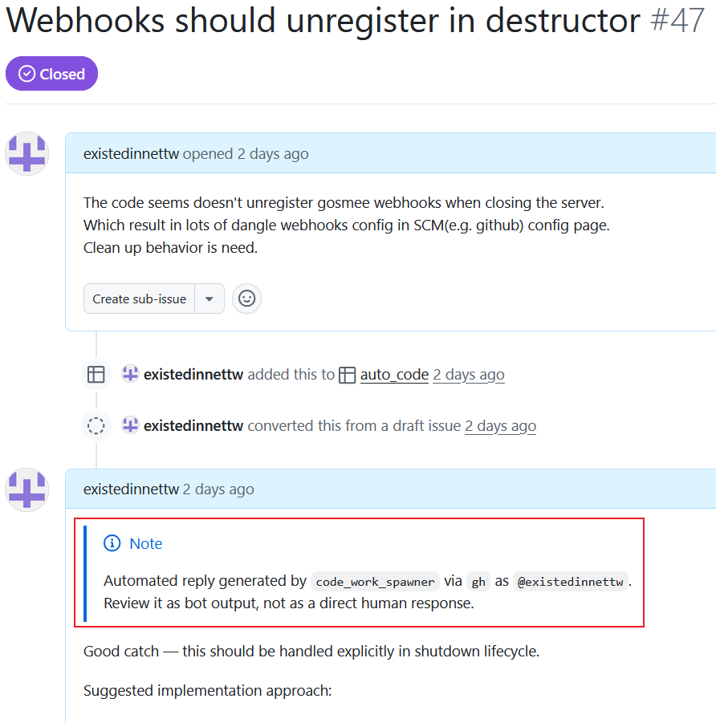

# code_work_spawner

Repository issue thread assistant configured by YAML.

It watches GitHub, GitLab, Gitea, or OpenProject issue events, reads threads, and triggers CLI responders such as `codex`, `opencode`, or `copilot-cli`.
Supports multi-repo config, responder fallback chains, isolated worktrees, and optional Discord or desktop notifications.



## Highlights

- Track issue events across multiple repositories
- Reply on mentions or meaningful thread updates
- Run planning and bug verification in isolated worktrees
- Send optional Discord and desktop notifications

## Requirements

- Dart SDK
- Authenticated `gh`, `glab`, `tea`, and/or OpenProject API credentials
- Local checkouts for configured repositories
- Optional responder CLIs (`codex`, `opencode`, `copilot-cli`)

## Config

Create `CWS_conf.yaml` using:
- [examples/README.md](examples/README.md)
- [examples/simple-github.yaml](examples/simple-github.yaml)
- [examples/simple-gitlab.yaml](examples/simple-gitlab.yaml)
- [examples/simple-gitea.yaml](examples/simple-gitea.yaml)

Environment placeholders (for example `${CWS_DISCORD_WEBHOOK}`) are resolved
from process env vars and from a `.env` file next to your config.

Logging level can be set by CLI flag or environment:
- CLI: `--log-level trace|debug|info|warn|error`
- Env: `CWS_LOG_LEVEL` (or `LOG_LEVEL`) with `trace|debug|info|warning|error|fatal`

Precedence: `--log-level` > env var > default `info`.
Minimal env example: [.env.example](.env.example).

Generate starter config:

```bash
dart run bin/code_work_spawner.dart init-config
# Write it to a file:
dart run bin/code_work_spawner.dart init-config --output agent-orchestrator.yaml
# Overwrite an existing file:
dart run bin/code_work_spawner.dart init-config --output agent-orchestrator.yaml --force
```

## Run

Generate code first:

```bash
dart run build_runner build --delete-conflicting-outputs
```

Run once:

```bash
dart run bin/code_work_spawner.dart --once
```

Run continuously:

```bash
dart run bin/code_work_spawner.dart
# With higher verbosity for troubleshooting:
dart run bin/code_work_spawner.dart --log-level debug
```

Override CLI paths if needed:

```bash
dart run bin/code_work_spawner.dart \
  --config /path/to/agent-orchestrator.yaml \
  --db /path/to/state.sqlite3 \
  --gh-command /usr/bin/gh \
  --glab-command /usr/bin/glab \
  --tea-command /usr/bin/tea
```

## Install Binary

Install latest release binary:

```bash
# export GH_TOKEN="$TOKEN" # If got 404, `GITHUB_TOKEN` also work
uv run https://github.com/existedinnettw/code_work_spawner/scripts/install.py
uv run https://$GH_TOKEN@raw.githubusercontent.com/existedinnettw/code_work_spawner/main/scripts/install.py --help
```

Install a specific version:

```bash
uv run https://github.com/existedinnettw/code_work_spawner/scripts/install.py --version v1.0.0
```

## Testing

```bash
dart run tool/validate_gherkin_test_format.dart
dart analyze
dart test
```

## ref

[agent-orchestrator](https://github.com/ComposioHQ/agent-orchestrator)
