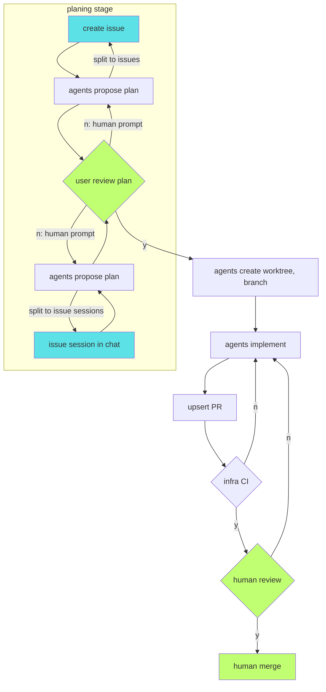
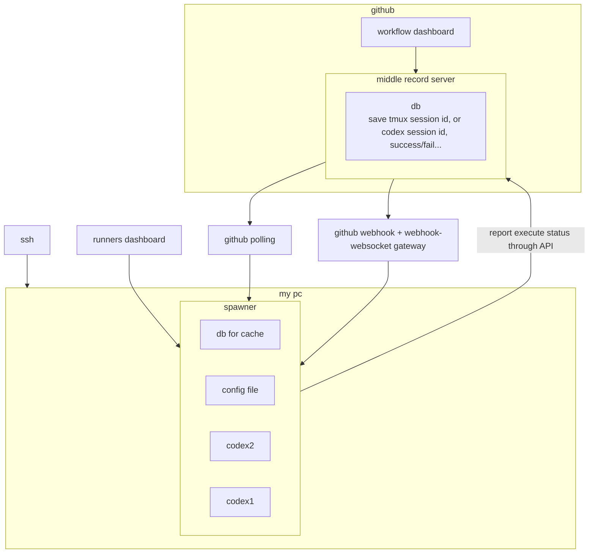

# arch

## coding flow 

## arch

## config option

* (issue) tracker
	* github(`gh`)
		* polling
		* `gh webhook forward`
		* webhook + smee.io(`gosmee`)
	* gitlab(`glab`)
		* webhook + smee.io
	* gitea(`tea`)
		* webhook + smee.io
	* openproject(`openproject-cli`)
		* polling
	* linear(`linear`)
* SCM
	* github
	* gitlab
	* gitea
* notifier
	* desktop
	* discord
	* slack
	* email
